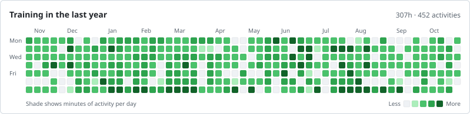
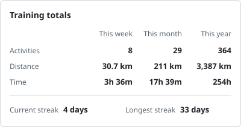
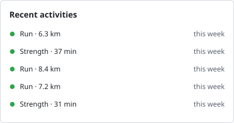

## Hi, I'm Eike 👋

[Website](https://eikekarbe.com) · [LinkedIn](https://www.linkedin.com/in/eike-karbe) · [Strava](https://www.strava.com/athletes/58442765)

When I'm not writing code, I'm training. Here's what that looks like:

<picture>
  <source media="(prefers-color-scheme: dark)" srcset="cards/heatmap-dark.svg">
  
</picture>
<picture>
  <source media="(prefers-color-scheme: dark)" srcset="cards/stats-dark.svg">
  
</picture>
<picture>
  <source media="(prefers-color-scheme: dark)" srcset="cards/recent-dark.svg">
  
</picture>

Synced nightly from Garmin Connect.
